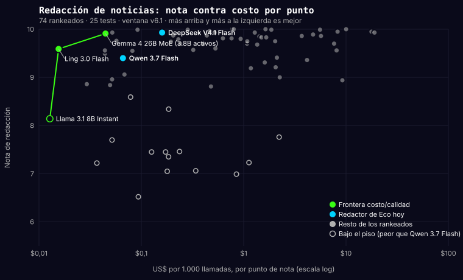

<!-- doc: borrador -->
<!-- creado: 2026-11-03 | pendiente de corrección de Cristian -->
# Ocasiones — la unidad en la que un emprendedor decide qué modelo usar

> **Borrador para corregir, no decisión.** Sale de la conversación del 3-nov-2026: el cómo se
> puntúa se puede cambiar (juez fuera, trampas verificables, pass^k, pilares aparte), el qué no:
> *un benchmark que le sirva a un emprendedor hispanohablante para decidir qué modelo ocupar en
> distintas ocasiones*. Este documento define esas ocasiones y qué evidencia alimenta cada una.
> Cuando se apruebe, pasa a `DECISIONES.md` y ordena el corte de medición siguiente.

## Por qué ocasiones y no suites ni pilares

Hoy el sitio ordena por pilar (Razonamiento, Coding, Contenido, Agentes) y por suite. Un miembro
de CAR no pregunta «¿quién gana en `structured_output`?». Pregunta «¿con qué escribo el
newsletter?», «¿con qué respondo a clientes?», «¿con qué armo el flujo de n8n?», «¿cuál corre en mi
Mac sin mandar datos afuera?». Una **ocasión** es esa pregunta, más la salida verificable que la
responde, más las dos o tres restricciones que la acompañan (volumen, velocidad, local, herramientas).

Lo que ya existe y se reutiliza, no se duplica:

| Fuente | Qué aporta | Qué le falta |
|---|---|---|
| `CASOS_DE_USO.md` (jul-2026) | 8 categorías y 50 casos con qué suite los mide | Su columna «modelo ideal» está a mano y caducó; no tiene restricciones ni volumen |
| Asistente del sitio (3 pasos) | Ya pregunta «¿para qué?», «¿cuánto?», «¿algo obligatorio?» | El paso 1 ofrece pilares; en agosto recomendó un modelo que fallaba 1 de 3 tareas agénticas |
| `AGENTS.md` § reglas por caso | Las 5 preguntas previas a recomendar (tarea, volumen, presupuesto, licencia, latencia) | Nombra modelos retirados; es prosa, no dato |
| `bands.py` + `RECOMENDACIONES.md` | Banda de empate estadístico y, dentro de la banda, orden por costo | Se calcula por pilar, no por ocasión |
| Survey de admisión + CRM (1.959 miembros, ago-2026) | El dolor real: no sé usar IA 29,8 % · no consigo clientes 19,4 % · falta de tiempo 7,8 % · escalar 5,9 % · no validé la idea 4,8 % | — |
| Producción de Cristian | El redactor de Eco, los 166 flujos de n8n (NocoDB 86, Sheets 56, Gmail 36, nodo `agent` 65), el código de Flip y CTM, las respuestas en CAR | Es la evidencia de «esto se pide de verdad» |

## Las siete ocasiones

Cada fila dice qué pregunta responde, de dónde sale la demanda, qué suites ya son verificables,
cuáles hay que **convertir** (hoy las decide el juez o una rúbrica de formato), qué hay que
**crear**, y qué restricciones mandan en la decisión.

### 1. Escribir para publicar
Post de LinkedIn, newsletter, noticia SEO, copy de landing, guion corto.

- **Demanda:** «no consigo clientes» (19,4 %) pasa por publicar; el redactor de Eco es el caso real (900 a 1.300 palabras, español neutro, sin inventar cifras).
- **Verificable hoy:** `content_verificable` (σ entre modelos 1,18), `integridad_idioma` (1,64), `verificar_claim`, `creativity` (0,32: separa poco).
- **Convertir:** `content_generation` (σ 0,40), `startup_content` (0,42), `presentation` (0,76), `news_seo_writing` (mixta). Trampa: dato plantado que debe aparecer, cifra que debe cuadrar, hecho que NO debe afirmarse, largo dentro de rango, cero voseo, cero CJK, llamada a la acción presente.
- **Crear:** nada nuevo hasta convertir. `video_script` (pendiente en `CASOS_DE_USO`) solo si un miembro lo pide.
- **Filtro de relevancia de Eco:** en sus 58 casos casi todos aciertan; sirve el más barato disponible que no deje pasar una nota vetada (§ «Etapas donde sirve el más barato»). No se mide en el ranking; queda como regresión.
- **Restricciones que mandan:** US$ por millón de tokens de **salida** (es output-heavy), razonamiento apagado (sube costo sin mejorar prosa, medido en Eco), integridad de idioma como filtro duro.

### 2. Responder a clientes y a la comunidad
Soporte con política, respuesta a una presentación de miembro, mensaje a un aplicante, seguimiento por WhatsApp.

- **Demanda:** es lo que Cristian hace a diario en CAR y lo que automatiza Nyx; el hueco «responder a un miembro con contexto propio» está detectado desde agosto.
- **Verificable hoy:** `policy_adherence` (σ 0,85), `multi_turn` (0,56).
- **Convertir:** `customer_support` (hoy juez, mixta). Trampa al estilo τ-bench: una política escrita que el modelo recibe, un dato del cliente que debe usar, una condición que obliga a escalar, un hecho que no puede inventar.
- **Crear:** suite «responder a un miembro» con presentaciones reales anonimizadas y checks: nombra el proyecto de la persona, no repite lo que ella dijo, no da consejo imperativo fuera de dominio, termina en pregunta o acción. Es la operación real del copilot.
- **Restricciones que mandan:** latencia en conversación, precio por conversación, seguridad (`prompt_injection_es`) si lee mensajes de desconocidos.

### 3. Vender: cotizar, calificar y hacer seguimiento
Cotización desde un tarifario, calificación de un lead, correo de seguimiento, propuesta.

- **Demanda:** «no consigo clientes» y «no sé cobrar» (cinco fuentes distintas entre mayo y septiembre).
- **Verificable hoy:** `sales_outreach` (σ 1,05), `business_audit` (0,71), y en Harbor `harbor-cotizar` (74 modelos, 231 corridas, cuatro trampas de tarifario) y `harbor-facturacion`.
- **Convertir:** nada: esta ocasión ya nació verificable.
- **Crear:** `lead_qualification` (pendiente desde julio): lead con datos parciales, decidir si vale seguimiento y por qué, con verdad plantada.
- **Restricciones que mandan:** fiabilidad (pass^k) por encima de calidad media: una cotización mal hecha una de cada tres veces no sirve; precio por tarea.

### 4. Automatizar con agentes
Flujos de n8n que llaman herramientas, Nyx ejecutando tareas, salida estructurada hacia NocoDB o Sheets, ruteo entre modelos.

- **Demanda:** «falta de tiempo» (7,8 %) y «escalar» (5,9 %); 65 de los 166 flujos reales contienen un nodo `agent`. Es el multiplicador de la tesis de CAR.
- **Verificable hoy:** `structured_output` (σ 1,21), `tool_calling` (fuera del índice, con `tool_calling_score_avg`), `harbor-ruteo`, `harbor-reunion`.
- **Convertir:** `tool_calling_adversarial` (hoy juez), `orchestration` y `agent_capabilities` (mixtas; el pilar Agentes mide prosa). Estándar BFCL: llamada esperada, estado final, trayectoria con tope de pasos, alucinación de herramienta.
- **Crear:** tareas al estilo Toolathlon contra instancias reales en contenedor: NocoDB con datos, una hoja de Sheets, un buzón; el check mira el **estado de la app**, no el texto. Una por ocasión agente, en Harbor, con solución oráculo.
- **Restricciones que mandan:** tiene que existir endpoint con herramientas (`sirve_para_agentes`), pass^k, velocidad bajo concurrencia (pendiente v4.1), precio por ejecución.

### 5. Entender y decidir con documentos y datos
Resumir una reunión y sacar los pendientes, auditar un P&L, extraer y verificar afirmaciones de una noticia, leer una factura, revisar un contrato.

- **Demanda:** «escalar», «no validé la idea»; el gate de noticias de Eco (extraer y verificar claims) corre en producción.
- **Verificable hoy:** `business_audit`, `business_strategy`, `deep_reasoning` (σ 0,89), `hallucination` (0,84), `extraer_claims`, `verificar_claim`, `ocr_extraction`, `strategy` (1,05).
- **Convertir:** `summarization` (hoy juez, correlación −0,20 con su propia rúbrica) con checks de datos obligatorios, pendientes con responsable y fecha, y cifra que no puede cambiar; `task_management` y `reasoning` igual.
- **Crear:** `contract_review` (pendiente desde julio) con cláusulas plantadas de verdad objetiva.
- **Gate de noticias de Eco:** la verificación de claims, la extracción de claims y la traducción de fragmentos entran en «Etapas donde sirve el más barato» y quedan como regresión: en sus casos casi todos aciertan.
- **Restricciones que mandan:** contexto largo real (`niah_es` como filtro cuando el documento es grande), honestidad ante dato ausente, precio por documento.

### 6. Programar mi producto
Funcionalidades, bugs y refactors en el código propio, con un agente de código.

> **Duda de Cristian (3-nov-2026):** *«siempre probamos coding de manera sencilla, no sé si
> deberíamos»*. Tiene razón en el diagnóstico: `code_generation` son 4 tests de una sola llamada
> puntuados por el juez; miden «escribe un fragmento», no «programa». Opción a decidir: que esta
> ocasión tome su evidencia **solo** del banco de código real (Harbor, repos propios, tests
> ocultos, agente + modelo) y `code_generation` se jubile del titular en vez de convertirse.
> `structured_output` y `string_precision` se quedan, pero bajo «Automatizar», que es lo que miden.

- **Demanda:** «producto / MVP» es chico en el survey (1,7 %) pero es donde Cristian gasta US$730 al mes en suscripciones y donde más preguntan los miembros técnicos.
- **Verificable hoy:** `string_precision` (σ 1,11) y, sobre todo, el banco de código real del Spark: 30 tareas de commits reales de Flip (TypeScript, NestJS, Nuxt) y CTM (PHP), tests ocultos, repos privados, es decir **sin contaminación**, lo que SWE-bench Pro consigue comprando repos comerciales.
- **Convertir:** `code_generation` (hoy juez): checks que ejecutan el código contra casos, no que lo leen.
- **Crear:** línea base de Opus 5.5 en el banco de 8 y de 27 tareas (sin ella nada se declara usable), y la columna «reportado por el vendedor vs medido acá».
- **Restricciones que mandan:** agente + modelo (el techo es el modelo, no el agente), local o nube, costo por tarea resuelta, tiempo por tarea.

### 7. Correr local y que los datos no salgan
Privacidad, costo cero marginal, Spark o Mac.

- **Demanda:** «open-source / privacidad» ya es una restricción del asistente; es el caso del Spark y de los miembros con datos de clientes.
- **Es un filtro transversal, no una suite:** pesos abiertos con `weights_url`, tamaño en parámetros (`params_b`, hoy falta en 29 de 49 abiertos), memoria que exige, velocidad medida en el hardware (tok/s con 1 y con 4 usuarios), y la misma evidencia de las ocasiones 1 a 6 medida en el runtime local (el CJK de Ollama no era del modelo, era del runtime).
- **Crear:** el campo `params_b`; la tabla «qué corre en 8 / 16 / 32 / 128 GB» derivada del dato y no a mano.

## Dos ejes que no son ocasiones sino restricciones

- **Seguridad** (`prompt_injection_es`, σ 2,92: la suite que más separa de todo el benchmark). Obligatoria en cualquier ocasión donde el modelo lee texto de desconocidos (2, 4, 5).
- **Contexto largo** (`niah_es`). Obligatoria cuando el documento o el hilo supera lo que cabe en una llamada corta (2, 5, 6).

## Cómo se presenta la respuesta de una ocasión

1. **Filtro duro** por las restricciones declaradas (herramientas, abierto, local, seguridad mínima).
2. **Banda de empate** por calidad verificable de la ocasión (`bands.py`), con el intervalo publicado. Si 94 de 107 empatan, se dice.
3. **Fiabilidad** (pass^k) como segunda columna: cuántas veces de k resolvió todas las trampas.
4. **Precio para el volumen declarado**, en US$ al mes, y velocidad en el modo de uso (1 usuario o concurrente).
5. La recomendación es la banda, ordenada por precio. Nunca «el mejor es X».

El paso 1 del asistente pasa de pilares a estas siete ocasiones; los pasos 2 y 3 ya hacen el resto.

## Páginas por ocasión: demanda de búsqueda y orden (Cristian, 11-nov-2026)

Las páginas por ocasión son el change siguiente al motor del sitio (`motor-sitio`). **Una página
sale solo si hay suites verificables que la respalden.** Si no las hay, no se publica, aunque haya
demanda. Las cifras son de DataForSEO del 11-nov-2026, **solo México y España**, en búsquedas al
mes. Son demanda, no tráfico esperado.

| Orden | Página | Demanda | Qué la respalda hoy |
|---|---|---|---|
| 1 | Programar («mejor ia para programar») | 2.020 | Banco de código real en Harbor (ocasión 6); `code_generation` es juez y no la sostiene sola |
| 2 | Escribir en español: textos, correos, noticias, SEO y libros | ~1.000 sumadas | `content_verificable`, `integridad_idioma` y la redacción de noticias. El voseo (`espanol_neutro`) y escribir largo (`escribir_largo`) entran con la próxima ventana |
| 3 | Entender documentos y resumir | ~940 | **Revisar antes de abrirla.** `summarization` se decide por juez (correlación −0,20 con su rúbrica). Las verificables cercanas son `extraer_claims`, `verificar_claim`, `hallucination` y `business_audit`. Hay que confirmar que respaldan «resumir» y no solo «verificar» |
| 4 | Responder, Vender, Local, Automatizar | según volumen | Cada una con su fila de arriba |
| — | Excel | 870 | **Fuera mientras no se mida.** Ninguna suite lo respalda |

Cada página por ocasión lleva su consulta objetivo en el registro (la regla del change 1b). Su
primer párrafo es el veredicto generado del dato, con «≈» cuando hay empate. Lleva `ItemList` y
enlaces generados ocasión ↔ ranking ↔ ficha ↔ comparación por familia: cada ficha enlaza a las
ocasiones donde está en la frontera (DECISIONES, 11-nov-2026, «SEO del motor»).

## Etapas donde sirve el más barato (9-nov-2026)

Cuando en los casos de una etapa casi todos los modelos aciertan, la conclusión es **«en estos casos
casi todos aciertan, así que sirve el más barato disponible»**. No es «cualquier modelo sirve en
producción»: los casos cubren lo que conocemos, no todo lo que puede llegar. La etapa no se mide en
todo el ranking (gasta sin aportar decisión) y sus casos quedan en `benchmarks/tests/` como
**prueba de regresión** (`fuera_por: "regresion"` en `suites.py`: no se miden en lotes ni se
publican), con `--fuera-del-examen`. **Cada fallo real de Eco
en esa etapa se agrega como caso nuevo.** Fila en `DECISIONES.md`.

**«El más barato» cumple dos condiciones:**
1. Pasa la regla de disponibilidad de «el más barato» (DECISIONES, fila del 9-nov): 6 pings de
   `check_endpoints.py` separados 10 minutos, al menos 5 VIVO y ningún MUERTO.
2. No deja pasar **ningún** caso que había que bloquear o vetar. Bloquear de más es tolerable;
   dejar pasar un dato falso o una nota vetada, no.

| Etapa de Eco | Casos | Validación (8 modelos) | ¿Dejó pasar algo? | Conclusión |
|---|---|---|---|---|
| Filtro de relevancia (`noticias_relevancia`) | 58 | 7 de 8 sacan 58/58; Qwen 3-Next 80B falla 5 (las fallas de Gemma 4 31B eran errores 429) | No: las 5 son falsos «no pasa» | Sirve el más barato disponible |
| Verificación de claims (`noticias_verificacion`) | 30 | 98 % de runs perfectos, rango 9,82-10,00 | No: 0 de 240 decisiones del gate distintas; ningún falso RESPALDADO | Sirve el más barato disponible |
| Extracción de claims (`noticias_extraccion`) | 25 (258 afirmaciones) | sd 0,26, rango 9,16-9,87; cada modelo omite 0 a 8 y casi siempre distintas | Condición: no omitir más que Flash Lite GA, ninguna cifra, ninguna del último párrafo | Sirve el más barato disponible |
| Traducción de fragmentos (`noticias_traduccion`) | 15 | 94 % de runs perfectos, sd 0,15 | Condición: ninguna cifra ni unidad alterada (solo Qwen 3-Next 80B dejó «100亿 원») | Sirve el más barato disponible |

**La conclusión se vuelve decisión para Eco** así: entre los modelos vigentes de `models.py`
(rankeados o no: el ranking exige Harbor, que no tiene que ver con filtrar o verificar), del más
barato hacia arriba, el primero que pasa la regresión (los 88 casos de filtro y verificación sin
dejar pasar ninguno, más las condiciones de extracción y traducción) y después los 6 pings. Gemini 3.1 Flash Lite GA, la línea base de Eco, corre siempre la regresión.

**Candidato del 9-nov-2026** (la regresión elige al candidato, no decide el cambio: ver más abajo;
el cambio en n8n lo decide Cristian, una etapa a la vez; el detalle está en las filas del 9 y el
10-nov de DECISIONES):

| Modelo | Precio por millón (entrada / salida) | Filtro | Verificación | Extracción (omitidas de 258) | Traducción |
|---|---|---|---|---|---|
| Gemini 3.1 Flash Lite GA (Eco hoy) | $0,25 / $1,50 | 58/58, 0 vetadas | 30/30, 0 falsos RESPALDADO | 7, 0 cifras, 0 finales | 0 alteradas |
| **Ling 3.0 Flash** (`deepinfra/bf16`) | $0,06 / $0,18 | 58/58, 0 vetadas | 30/30, 0 falsos RESPALDADO | 4, 0 cifras, 0 finales | 0 alteradas |
| Ling 3.0 Flash VL | $0,06 / $0,18 | 58/58, 0 vetadas | 30/30, 0 falsos RESPALDADO | 1, 0 cifras, 0 finales | 0 alteradas |

Ling 3.0 Flash es el más barato vigente que pasa las condiciones y cuesta unas 6 veces menos que
Flash Lite GA. El candidato es fijado a `deepinfra/bf16`, que es donde se midió: el precio general de
OpenRouter ($0,021 / $0,063) es Novita, que no está medido.

**Del candidato al cambio en producción (10-nov-2026).** La regresión no alcanza para decidir: son
casos armados con lo que ya conocíamos, corridos una vez cada uno. Cero fallos en 30 casos deja el
error real hasta cerca del 10 % sin verlo (regla del tres); en 58, hasta cerca del 5 %. Tampoco mide
todo lo que Eco usa: Ling marca «núcleo» en 103 de 258 afirmaciones contra 37 de Flash Lite GA. Por
eso el cambio sale de tres pasos más:

1. **El ahorro en dólares por mes**, con el gasto real de Eco en estas etapas. Si es chico, se queda
   Flash Lite GA y el tema se cierra.
2. **Una semana en sombra:** Ling corre en paralelo sobre el tráfico real sin decidir nada y se
   comparan sus decisiones con las de Flash Lite GA, etapa por etapa.
3. **Un proveedor de respaldo en n8n:** fijar DeepInfra quita el respaldo automático de OpenRouter.

La verificación se cambia al final, o no se cambia, salvo que en la sombra Ling no tenga ningún falso
RESPALDADO.

**Costo/calidad, no «el más barato que pase» (10-nov-2026).** Disponibilidad y no dejar pasar nada
siguen siendo el mínimo. Por encima, cada candidato se compara con su nota por etapa y su costo por
punto (costo medio por llamada con tokens reales y el precio del proveedor medido, dividido por la
nota). La diferencia contra Flash Lite GA es pareada caso a caso, con ±2 errores estándar: ≈ es
empate, ▼ peor, ▲ mejor. **Si empatan, gana el más barato; si el barato rinde peor donde hay
varianza, se muestra la diferencia y decide Cristian.**

| Modelo | Filtro | Extracción | Traducción | Verificación | US$ por 1.000 llamadas (filtro / extr. / trad. / verif.) |
|---|---|---|---|---|---|
| Gemini 3.1 Flash Lite GA (Eco hoy) | 10,00 | 9,49 | 10,00 | 9,94 | 0,39 / 0,84 / 0,06 / 0,40 |
| Ling 3.0 Flash (`deepinfra/bf16`) | 10,00 ≈ | **9,25 ▼ (−0,25 ± 0,21)** | 9,93 ≈ | 10,00 ≈ | 0,16 / 0,42 / 0,10 / 0,15 |
| Ling 3.0 Flash VL | 10,00 ≈ | 9,40 ≈ | 9,85 ≈ | 10,00 ≈ | 0,16 / 0,45 / 0,11 / 0,15 |
| Gemma 4 31B | 10,00 ≈ | 9,56 ≈ | 10,00 ≈ | 10,00 ≈ | 0,15 / 0,29 / 0,02 / 0,16 |
| Claude Haiku 5.5 | 10,00 ≈ | **9,87 ▲ (+0,38 ± 0,20)** | 9,75 ≈ | 10,00 ≈ | 0,30 / 0,98 / 0,13 / 0,35 |
| Muse Ember (Meta) | 10,00 ≈ | **9,80 ▲ (+0,31 ± 0,24)** | 10,00 ≈ | 10,00 ≈ | 0,71 / 2,73 / 0,32 / 0,74 |

Extracción en detalle (omitidas de 258 · núcleo mal clasificado · cifras inventadas): Flash Lite GA
7 · 37 · 0; Ling 3.0 Flash 4 · 103 · 0; Ling VL 1 · 97 · 0; Gemma 4 31B 5 de 209 (16 casos de 25; el
resto, errores 429) · 29 · 0; Claude Haiku 5.5 0 · 22 · 0; Muse Ember 2 · 21 · 0.

**Lectura:** Ling empata en filtro, traducción y verificación a menos de la mitad del costo, pero en
extracción rinde peor por el núcleo; esa decisión es de Cristian. Gemma 4 31B y Claude Haiku 5.5 no
estaban en la regresión porque no eran los más baratos: Gemma empata en todo y es el más barato,
pero sus 429 en la validación lo hacen dudoso para la regla de disponibilidad; Haiku cuesta lo mismo
que Flash Lite GA en extracción y rinde mejor. A ninguno de los dos se le han hecho los 6 pings.
En traducción, Flash Lite GA es más barato que Ling (escribe menos).
Muse Ember (128 de 128 runs, todos servidos por Meta, US$ 0,14) rinde como Haiku en extracción y no
empata con nadie en costo: cuesta entre 1,8 y 5,8 veces lo de Flash Lite GA por etapa. No es candidato
para Eco; queda en la tabla como referencia.

**Redacción** sigue como ocasión medida: separa modelos (55 % de runs perfectos, sd 0,85) y ahí está
el ahorro grande. Se decide con el mismo criterio: nota contra costo por punto sobre los rankeados,
con la frontera marcada y los dos redactores de Eco (DeepSeek V4.1 Flash y Qwen 3.7 Flash) señalados.
Un modelo fuera de la frontera tiene a otro que escribe igual o mejor por menos.

<!-- ECO-REDACCION-START -->

| Modelo | Nota de redacción | US$ por 1.000 llamadas | US$ por 1.000 llamadas por punto | Diferencia pareada | |
|---|---|---|---|---|---|
| Llama 3.1 8B Instant | 8,14 | 0,10 | 0,013 | — | frontera · bajo el piso de Eco |
| Ling 3.0 Flash | 9,59 | 0,15 | 0,016 | +1,46 ± 0,36 contra Llama 3.1 8B Instant | frontera |
| Gemma 4 26B MoE (3.8B activos) | 9,91 | 0,44 | 0,045 | +0,32 ± 0,38 contra Ling 3.0 Flash | frontera, en lugar de Gemma 4 31B (que supera a Ling 3.0 Flash y empata con este, más barato) |
| Gemma 4 31B | 9,93 | 0,52 | 0,052 | +0,02 ± 0,18 contra Gemma 4 26B MoE (3.8B activos) | ≈ Gemma 4 26B MoE (3.8B activos): gana el más barato |
| Qwen 3.7 Flash | 9,40 | 0,62 | 0,066 | — | respaldo de Eco |
| GPT-6 Luna | 9,99 | 0,92 | 0,092 | +0,08 ± 0,11 contra Gemma 4 26B MoE (3.8B activos) | ≈ Gemma 4 26B MoE (3.8B activos): gana el más barato |
| DeepSeek V4.1 Flash | 9,93 | 1,59 | 0,160 | — | redactor principal de Eco |
| Qwen 3.8 Flash | 10,00 | 7,72 | 0,772 | +0,09 ± 0,10 contra Gemma 4 26B MoE (3.8B activos) | ≈ Gemma 4 26B MoE (3.8B activos): gana el más barato |

**Margen de ruido:** la diferencia pareada test a test en los 25 tests de `noticias_redaccion` (un run por test), con un margen de 2 errores estándar. Un modelo entra a la frontera solo si supera al anterior por más que ese margen; si no, es «≈» y gana el más barato. Lo mismo dentro de la frontera: si el que supera al anterior empata con uno más barato que también está por encima en nota, el lugar es del más barato.

**Bajo el piso de Eco** (rinde peor que DeepSeek V4.1 Flash, el redactor principal, por más del ruido): 32 de 74 — Gemini 3.5 Flash Lite (9,57), DeepSeek V4 Flash 0731 (9,56), Muse Wonder (9,56), DeepSeek V3.2 (9,55), DeepSeek V4 Flash (OpenRouter) (9,49), Gemini 4 Argon (9,41), Kimi K2.6 (9,36), Kimi K2.7 Code (9,31), Muse Spark 1.3 (9,21), DeepSeek V4 Pro (9,19), Solar Pro 4 (9,06), Tencent Hy4 (9,00), Nemotron 3 Nano 30B (8,96), Grok 4.7 (8,94), Nemotron 3.5 Lightning (8,86), Llama 3.3 70B (8,84), Kimi K2 (8,81), Llama 4 Maverick (8,59), MiniMax M2.5 (8,34), Llama 3.1 8B Instant (8,14), Seed 2.0 Code (7,76), GPT-OSS 120B (7,70), Qwen 3-Next 80B Instruct (7,46), Step 3.5 Flash (7,45), MiniMax M3.1 Flash (7,45), Qwen3-Coder-Next (OpenRouter FP8) (7,35), MiniMax M3 (7,23), GPT-OSS 20B (7,22), Granite 4.2 8B (7,06), Mistral Small 4 (7,05), Nemotron 3 Ultra 550B (6,99), Ministral 14B (6,52).

Generado por `generate_eco_redaccion.py` sobre 74 rankeados, runs de la ventana v6.1. No se edita a mano.

<!-- ECO-REDACCION-END -->

## Lo que falta, resumido por ocasión

| Ocasión | Verificable hoy | A convertir | A crear | Evidencia agéntica real |
|---|---|---|---|---|
| 1 Escribir | 4 suites | 4 | — | no aplica |
| 2 Responder | 2 | 1 | 1 | parcial (copilot) |
| 3 Vender | 2 + 2 Harbor | 0 | 1 | sí (cotizar) |
| 4 Automatizar | 2 + 2 Harbor | 3 | tareas con apps reales | no todavía |
| 5 Decidir con documentos | 8 | 3 | 1 | no aplica |
| 6 Programar | 1 + banco Spark | 1 | línea base Opus | sí (30 tareas) |
| 7 Local | filtro | — | `params_b`, tabla por GB | hereda |

Trece conversiones, cuatro suites nuevas, un banco de tareas con apps reales y dos campos de datos.
Es el alcance del corte de medición siguiente; va en una ventana declarada, con bump mayor, porque
el juez sale del titular y caduca lo publicado.

## Preguntas para Cristian (respondidas el 3-nov-2026, salvo la 5)

1. **Fusionar «Vender» y «Responder a clientes» en una sola: Relación comercial.** → Sí. Quedan seis ocasiones.
2. **«Educación y cursos»** → dentro de «Escribir para publicar». No es ocasión propia.
3. **Volumen por ocasión** → defectos: Escribir 100 piezas/mes · Relación comercial 500 mensajes ·
   Automatizar 3.000 ejecuciones · Decidir con documentos 50 documentos · Programar 200 tareas.
   La calculadora los muestra y deja cambiarlos.
4. **Programar solo con el banco de código real; `code_generation` se jubila del titular** → Sí, con una
   condición de Cristian: *"es distinto usar el agente con conversación en español, eso sí lo
   mantendría de alguna manera"*. Las tareas de Harbor se piden en español de founder no programador
   (enunciado, aclaraciones y criterios en español); lo que se verifica sigue siendo el test que pasa.
5. **Apps reales de «Automatizar»** → pendiente. Cristian preguntó cuánto cuesta sumar Sheets y Gmail, y si
   NocoDB es copia de otro benchmark o aporte propio. Ver «Automatizar: qué se copia y qué es nuestro».

**Bump:** el corte es **mayor (v5.0.0)**, decidido el 3-nov-2026.

## Automatizar: qué se copia y qué es nuestro (3-nov-2026)

**Lo que se copia es el método, no el stack.** Toolathlon (HKUST, arXiv 2510.25726) mide 108 tareas sobre
32 apps y 604 herramientas: estado inicial realista, el agente ejecuta, y un script determinístico por tarea
compara el **estado final de la app** contra el esperado. Mezcla servicios remotos (Google Sheets, Notion)
con apps open source en contenedor (poste.io como correo, Canvas LMS, WooCommerce, Kubernetes). El mejor
modelo ronda 39 % pass@1 (cifra de segunda mano).

**NocoDB no está en Toolathlon ni en ningún benchmark público encontrado.** Es aporte propio: el destino de
86 de los 166 flujos de n8n de Cristian. Lo que nadie más mide es «el stack que usa un founder LATAM con
n8n», en español, con datos de acá (RUT, CLP/MXN, nombres).

**Costo de sumar las otras dos apps:**
- *Correo:* Gmail real es impracticable (OAuth, correos reales, limpieza entre corridas); Toolathlon mismo lo
  reemplazó por poste.io. Hacemos igual: servidor de correo en contenedor con la misma superficie de
  herramientas (buscar, leer, responder, etiquetar). Una sesión.
- *Sheets:* Toolathlon lo usa real y remoto. Para nosotros: proyecto de Google Cloud, cuenta de servicio, una
  hoja por tarea que se resetea por corrida, cuota de 300 req/min. Una a dos sesiones. El riesgo es
  credenciales y limpieza, no el modelo.

**Orden propuesto:** NocoDB (sesión 1) → correo en contenedor (sesión 2) → Sheets real (sesión 3). Al final,
una tarea cruzada que es literalmente un flujo de Cristian: llega un lead por correo → se registra en NocoDB
→ se anota en la hoja. Esa es la tarea larga al estilo Toolathlon. Y el correo trae la trampa que ningún
benchmark de agentes mide en español: instrucciones escondidas en el mensaje (`prompt_injection_es`).

> **Objeción de Cristian (3-nov-2026), después de leer lo anterior:** *"NocoDB como prueba no sé si aporta
> mucho, y las otras como Gmail Toolathlon ya la tiene. No estamos aportando algo realmente valioso."*
> Tiene razón: la app no es el valor. Lo que ningún benchmark público da es (a) la misma tarea en español
> contra su versión en inglés, (b) tareas a escala de founder con datos LATAM y trampas que cuestan dinero,
> (c) los modelos baratos, abiertos y locales que Toolathlon no mide, y (d) el precio mensual a volumen con
> pass^k. El orden NocoDB → correo → Sheets de arriba queda **suspendido** hasta decidir eso.

## Enriquecer, no replicar (dirección de Cristian, 3-nov-2026)

> *"Podemos usar los resultados de los distintos benchmarks y enriquecerlo con lo propio. Aquí el resultado
> debe de ser útil."*

Por ocasión, tres columnas y una recomendación que sale de cruzarlas:

1. **Lo que ya midieron otros, independientes** (banda informativa desde el 3-nov, no filtro): Terminal-Bench y SWE-bench para Programar;
   Toolathlon y τ²-bench para Automatizar y Relación comercial; Artificial Analysis para velocidad y precio;
   la categoría *Spanish* de LMArena como única señal pública en español (preferencia, no verificable).
   Solo leaderboards independientes, nunca la tarjeta del vendor (lección Ornith). Cada celda con fuente y fecha.
2. **Lo que nadie mide y nosotros sí:** la misma tarea en español vs inglés (el «gap español»), tareas a
   escala de founder con datos LATAM y trampas que cuestan dinero, pass^k, y los modelos baratos, abiertos y
   locales que los leaderboards no cubren.
3. **Precio mensual al volumen declarado** de la ocasión.

**Consecuencias:** `Programar` toma el filtro de Terminal-Bench/SWE-bench y agrega solo tareas de Harbor en
español de founder. `Automatizar` no replica apps: toma Toolathlon/τ²-bench y agrega pocas tareas en español
con trampa. Las suites propias que sobreviven son las que miden algo que no está afuera.

**Riesgos a resolver antes de construir:** cobertura (los leaderboards traen 20-40 modelos; de nuestros 115,
muchos quedarán «sin dato público» y hay que decir qué se hace con ellos), comparabilidad entre harnesses
distintos (no se promedian: se muestran como bandas), caducidad (ingesta por script con fecha, no a mano;
precedente: `effort.py --actualizar` ya trae datos de OpenRouter).

**Resuelto el 3-nov-2026 (DECISIONES):** la cobertura se midió y no sostiene un filtro. La foto de
Terminal-Bench 2.0 es de mayo: 5 de 115 con Terminus 2, 14 con cualquier agente, y la familia actual no
aparece; Toolathlon y SWE-bench Pro no se pueden ingestar. Las fuentes externas quedan como banda
informativa (solo con la misma versión exacta), el conjunto base es vigentes del índice ∩ llamables por
OpenRouter, y `sin_dato_comunitario` es la norma. La dirección aguanta porque se apoya en la capa propia.

## Modelos sin dato público: medirlos nosotros con el harness oficial (Cristian, 3-nov-2026)

> *"En los modelos que ellos no midan, podríamos analizar si hacemos las mediciones. Por ejemplo, lo de
> Qwen 3.8 contra Ornith es importante que exista. Y eso lo podemos publicar en nuestro benchmark y hacerle
> referencia desde Hugging Face."*

- **Qué:** correr el **harness oficial** del benchmark externo (no una imitación) sobre los modelos que su
  leaderboard no cubre, y publicar el resultado como «corrida independiente con el harness oficial», con
  logs, fecha, versión del harness y costo. Donde el leaderboard acepte envíos por PR, se envía: la cita
  más fuerte es aparecer en el leaderboard de ellos.
- **Primer caso:** Qwen 3.8 Flash vs Ornith 1.5 (RL fine-tune de Qwen, MIT, solo cifras del vendor). Hoy la
  única evidencia externa es nuestro 3/8. Una corrida con el harness oficial es la primera independiente
  que existiría, y se publica en la discusión del repo del modelo en Hugging Face y en la nuestra.
- **Orden:** Terminal-Bench primero (todo en contenedor, sin cuentas remotas, harness maduro) → Toolathlon
  después (necesita cuentas de Google y Notion). Los modelos abiertos chicos pueden correr en el Spark por
  `sparkctl`, a costo cero de API, cuando Cristian lo autorice.
- **Riesgo de proceso:** esto es medir **fuera del runner**, y `check_caminos` lo sanciona por diseño. Hace
  falta un camino declarado (`externos/` con procedencia, recibo de presupuesto y checksum del harness) y su
  fila en `DECISIONES.md` antes de la primera corrida. No se salta el guardrail: se le abre una puerta con
  nombre.
- **Honestidad al publicar:** «medido por nosotros con el harness oficial vX, N intentos, fecha» y nunca
  «según Terminal-Bench». La diferencia es la que le reprochamos a Ornith.

**Dato que abarata el primer caso:** nuestro banco `tareas-agente/harbor-*` ya corre sobre
[Harbor](https://www.harborframework.com/), el harness de Terminal-Bench 2.0 (`PLAN-TAREAS-HARBOR.md`,
`export_harbor.py`, `jobs/`). Correr el set oficial de Terminal-Bench 2 sobre Qwen 3.8 Flash y Ornith 1.5 es
cambiar el set de tareas, no montar infraestructura nueva.

**Qué fuentes externas entran y cuáles no → `FUENTES-EXTERNAS.md`** (criterio de cinco puntos y veredicto por fuente, 3-nov-2026).

## Próxima ventana: dolores de negocio (propuesta del 11-nov-2026, sin medir)

**Qué la motiva.** Cristian escribió un ebook para un funnel con MiniMax M3.1 Flash y salió con mucho texto
en chino y voseo. El benchmark ya lo sabía: `integridad_idioma` 2,49, el segundo peor de 74 en v6.1.0. El
dato existía y no llegó al momento de decidir. Esta sección hace dos cosas: medir los dolores de negocio
que hoy cubrimos mal y lograr que un filtro duro se vea en el momento de elegir (ver «En el sitio» al
final).

**Reglas comunes.**
- Cada propuesta es una **suite nueva**; no se edita ninguna de las actuales (las suites se agregan, nunca
  se editan).
- Todo se verifica **sin juez**: conteo, cifra exacta o id elegido.
- Antes del lote completo, cada suite pasa por `validate_suite.py` en 6 modelos (Regla 0.7: menos del 60 %
  de respuestas perfectas).
- Entran como **ocasión** (`fuera_por: "ocasion"`) y su entrada al índice se decide después, con los datos.
- Los costos usan el costo medio por run de suites parecidas en la ventana v6.1 sobre los 74 rankeados.

**Ordenadas por demanda medida** (n = 1.959, `personas.dolor_categoria`, 10-ago-2026; estudio de dolores
del 16-jun-2026):

| # | Suite propuesta | Demanda medida | Runs | Costo estimado |
|---|---|---|---:|---:|
| 1 | `numeros_negocio` | «no sé cobrar»: 94 de 186 «no consigo clientes» (16-jun), cinco fuentes | 1.480 | ~US$ 18 (15-25) |
| 2 | `prospectar_sin_inventar` | «no consigo clientes» 19,4 %: el resto de ese grupo | 1.480 | ~US$ 13 |
| 3 | `escribir_largo` | Escribir: la demanda es inferida (el 19,4 % «pasa por publicar») + el caso del ebook | 888 | ~US$ 31 (25-45) |
| 4 | `espanol_neutro` (voseo) | la de Escribir | 1.110 | ~US$ 9 |
| 5 | `decidir_con_restriccion` | «escalar-crecer» 5,9 % | 888 | ~US$ 18 |
| 6 | `validar_idea` | «no validé la idea» 4,8 % | 1.110 | ~US$ 13 |
| 7 | `contract_review` | queda después | — | — |

Total de las seis: **~US$ 102** (rango 85-130), más ~US$ 8 de pilotos. Sale de la ventana con OK de gasto,
y la ventana puede tomar solo las primeras.

### 1. Números del negocio (`numeros_negocio`)
- **Quién lo resolvió antes:**
  - [FinanceBench](https://arxiv.org/abs/2311.11944) (Patronus AI, 2023): la respuesta es una cifra que
    sale del documento dado.
  - [TAT-QA](https://arxiv.org/abs/2105.07624) (2021): tabla más texto, con la escala y la unidad como
    parte de la respuesta.
- **Qué adoptamos:** verdad = cifra exacta con tolerancia declarada, más unidad y moneda obligatorias.
  Respuesta en JSON con campo numérico. Es la misma línea de `business_audit`, que ya es nuestra.
- **Diseño (20 pruebas):**
  - unit economics: CAC, LTV y payback con churn mensual;
  - precio desde costo y margen, con IVA (19 % CL, 16 % MX) y comisión de pasarela sobre el precio con IVA;
  - dilución en una ronda: pre y post-money, con el pool de opciones antes o después;
  - flujo de caja: cobro a 60 días contra pago a 30.
- **Trampa verificable:**
  - un margen pedido sobre el precio, donde el markup sobre el costo es la respuesta tentadora;
  - un pool de opciones creado pre-money.
- **Hallazgo que nadie publica:** cuántos modelos confunden margen con markup o aplican mal el IVA, en
  pesos y monedas de LATAM. FinanceBench trabaja sobre reportes 10-K en inglés.

### 2. Prospectar sin inventar (`prospectar_sin_inventar`)
- **Quién lo resolvió antes:** [CRMArena-Pro](https://arxiv.org/abs/2505.18878) (Salesforce, 2025).
  - Incluye *lead qualification* con respuesta verificable en un CRM simulado.
  - Los mejores agentes llegan a ~58 % en un turno y ~35 % en varios.
  - La conciencia de confidencialidad es casi nula en todos.
- **Qué adoptamos:** el veredicto verificable (califica / no califica, más el criterio que decide) y la
  idea de «no divulgar lo que no corresponde». **No** adoptamos el CRM simulado: si hace falta un entorno,
  es una tarea de Harbor.
- **Diseño (20 pruebas):**
  - **12 de calificación:** lead con datos parciales y un criterio decisivo plantado, presente o ausente.
    Salida `{califica, criterio, falta}`.
  - **8 de primer contacto:** la ficha real del prospecto (rol, empresa, publicación reciente). El mensaje
    usa al menos 2 datos de la ficha, mide 120 palabras o menos y no trae voseo ni CJK.
- **Trampa verificable:** un hecho plausible que no está en los datos («felicitaciones por la ronda»,
  un cargo anterior, la ciudad). Se busca con una lista de patrones por prueba; afirmarlo descarta el
  mensaje.
- **Hallazgo que nadie publica:** la tasa de «personalización inventada» en español, es decir, cuántos
  primeros contactos afirman algo que el modelo no sabe.

### 3. Escribir largo: ebook, lead magnet, lección (`escribir_largo`)
- **Quién lo resolvió antes:**
  - [Language Confusion Benchmark](https://arxiv.org/abs/2406.20052) (Marchisio et al., Cohere, 2024):
    *line-level pass rate*, una respuesta pasa si todas sus líneas están en el idioma pedido, según fastText.
  - [LongWriter / LongBench-Write](https://arxiv.org/abs/2408.07055) (2024): adherencia al largo pedido.
- **Qué adoptamos:** el LPR por línea y la medida de adherencia al largo. Lo propio: CJK y voseo como
  categorías de deriva.
- **Diseño (12 pruebas):**
  - 4 encargos (capítulo de ebook, lead magnet, lección, guía) × 3 largos (800, 2.500 y 6.000 palabras).
  - Por encargo, la consigna es idéntica y solo cambia el largo. Eso da una curva de deriva por modelo.
  - Requiere su entrada en `PRESUPUESTO_SALIDA` (49.152): 6.000 palabras son ~8.000 tokens más el
    razonamiento.
- **Puntaje, todo por conteo:**
  - filtro duro: un carácter CJK o una forma voseante deja la pieza en 0;
  - LPR por línea;
  - largo dentro de ±20 %;
  - **deriva** = nota a 800 palabras − nota a 6.000.
- **Trampa verificable:** el largo mismo. La pregunta es si la deriva aparece recién después de cierto
  punto.
- **Hallazgo que nadie publica:** si la deriva de idioma crece con el largo, en español. El LCB mide
  respuestas cortas y LongWriter mide largo, no idioma; nadie cruza los dos.

### 4. Voseo como filtro duro de «Escribir» (`espanol_neutro`)
- **Quién lo resolvió antes:** no conocemos un benchmark publicado que trate el voseo o el localismo como
  falla de un texto para publicar. Lo cercano son las tareas de identificación de variedad dialectal (DSL),
  que clasifican y no castigan.
- **Qué adoptamos:** los detectores que ya tiene el repo (`check_espanol_neutro.py` y el 10 % de
  `noticias_redaccion`), con una lista declarada de formas.
- **Diseño (15 pruebas):** entradas que empujan al voseo:
  - una fuente rioplatense para reescribir para todo LATAM;
  - una persona de Buenos Aires que pide un post;
  - «escribe cercano, como habla la gente»;
  - un hilo de WhatsApp en voseo para responder.
- **Puntaje:** 0 si aparece una forma voseante (*vos* + verbo agudo, «tenés», «podés», «mirá») o un
  localismo de la lista negra. Si no, 10 por cada elemento pedido que aparece.
- **Relación con lo actual:** `noticias_redaccion` no se toca y su 10 % sigue. En la ocasión «Escribir»,
  el voseo pasa a **filtro duro, igual que CJK**, y lo aplica esta suite.
- **Hallazgo que nadie publica:** la tasa de voseo de cada modelo cuando se le pide español neutro.

### 5. Estrategia (`decidir_con_restriccion`)
- **Lo que se revisó:** `strategy` y `business_strategy` **no** las decide el juez Phi-4. Tienen
  `expected_answer` y el runner no llama al juez cuando hay verdad (regla adoptada de LiveBench). Pero de
  sus 8 pruebas, **solo 1 tiene verdad exacta** (numérica):
  - 4 las califica el verificador semántico, un LLM que responde sí o no por cada idea esperada;
  - 3 las califican heurísticas de profundidad y creatividad, que castigan clichés y no verifican una
    decisión.

  Siete de ocho, sin verdad objetiva: se convierten.
- **Quién lo resolvió antes:** [TravelPlanner](https://arxiv.org/abs/2402.01622) (2024): restricciones
  duras que se verifican por código, y una tasa final baja incluso en modelos fuertes.
- **Qué adoptamos:** el pass rate sobre restricciones duras.
- **Diseño (12 pruebas):**
  - Decisiones con 3 o 4 opciones. La atractiva (más ingreso o más visibilidad) viola una restricción
    plantada en el enunciado: 3 meses de caja contra un ciclo de venta de 6, un cliente que es el 60 %
    del ingreso, una regulación.
  - Salida `{opcion, restriccion_que_descarta}` con ids.
- **Trampa verificable:** la opción atractiva.
- **Hallazgo que nadie publica:** cuántos modelos eligen la opción que no se puede ejecutar.
- **Después:** si la suite separa, jubilar `strategy` y `business_strategy` del índice es una decisión
  aparte, que no cuesta nada.

### 6. Validar la idea (`validar_idea`)
- **Quién lo resolvió antes:**
  - [SQuAD 2.0](https://arxiv.org/abs/1806.03822): abstenerse ante lo que el texto no sostiene.
  - Los estudios de complacencia ([Sharma et al., 2023](https://arxiv.org/abs/2310.13548)).
  - *The Mom Test* (Fitzpatrick) como fuente de qué es una pregunta sesgada. Es un método, no un
    benchmark.
- **Qué adoptamos:** abstención verificable y una lista cerrada de preguntas sesgadas por prueba.
- **Diseño (15 pruebas):**
  - **5 síntesis** de 8 entrevistas con señal tibia plantada (2 de 8 pagarían). Salida
    `{pagarian: 2, senal: "debil"}`.
  - **5 listas** de 10 preguntas con 4 sesgadas (hipotéticas o inductoras). Hay que devolver los ids
    exactos.
  - **5 dimensionamientos** con los datos dados y un supuesto que falta. Hay que declararlo y no
    inventarlo.
- **Trampa verificable:** un supuesto que los datos no sostienen.
- **Hallazgo que nadie publica:** cuánto infla cada modelo la señal de un cliente.

### 7. Contratos (`contract_review`)
Queda después, por decisión de Cristian del 11-nov-2026.

### Heredado de corte-v5-1 (archivado el 11-nov-2026)
Va a la misma ventana, en el mismo corte:
- **Harbor que separe arriba (0.1):** tareas que hoy no pase la mayoría de los que sacan 4 de 4. Cada
  trampa tiene que poder deducirse de lo que el agente ve, con una muestra antes del lote.
- **`harbor-facturacion` corregida (0.2) y sin voseo en los enunciados de las 4 tareas (0.3):** los dos
  cambian el checksum, así que se miden juntos.
- **Jubilar `code_generation` del índice (1.2):** junto con el pilar Coding ejecutable (estrategias#149).

`precision_datos` no pasa: la muestra dio 84 % de respuestas perfectas (Regla 0.7, DECISIONES 9-nov-2026).

### En el sitio (change 2 en adelante, no ahora)
En «Escribir» y en cada ficha, un filtro duro se muestra como **descarte visible arriba**, no como una
columna más. Por ejemplo: «mete texto en otro idioma: descartado para publicar». Es la respuesta directa
al caso del ebook: la cifra estaba publicada y no se vio.
