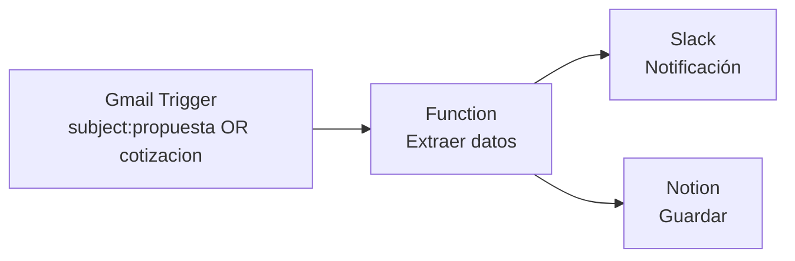

# DeepSeek V4 Pro (0813) — multi_turn/requirements_change

- model_id: `deepseek/deepseek-v4-pro-0813`
- success: True  | final: 4.28 | quality: 4.0
- latency_total: 37.265s | tokens_per_second: 64.8
- input_tokens: 323 | output_tokens: 2415

## Entrada exacta (lo que recibió el modelo)

**system:**

Eres un asistente tecnico para emprendedores que trabajan con N8N.

**user:**

Necesito un workflow en N8N que lea emails de Gmail, extraiga los datos del remitente, y los guarde en un Google Sheet.

**assistant:**

Perfecto, ese workflow es bastante directo. Te explico los pasos:

1. **Trigger**: Gmail Trigger (se activa con cada email nuevo)
2. **Extraer datos**: Function node para parsear remitente, asunto, fecha
3. **Guardar**: Google Sheets node para agregar una fila

Los campos a extraer serian: nombre del remitente, email, asunto, fecha. Quieres que te detalle la configuracion de cada nodo?

**user:**

En realidad, cambio de idea. No quiero Google Sheets, quiero que los datos vayan a Notion. Ademas, quiero que el workflow filtre solo los emails que tengan la palabra 'propuesta' o 'cotizacion' en el asunto. Y que me mande una notificacion a Slack cuando llegue uno.


## Respuesta completa

Perfecto, vamos a adaptar el flujo a tus nuevos requisitos:

- **Leer** correos de Gmail.
- **Filtrar** solo los que tengan “propuesta” o “cotización” en el asunto.
- **Extraer** datos del remitente (nombre y email), asunto y fecha.
- **Notificar** a Slack.
- **Guardar** la información en Notion.

El flujo en N8N quedaría así:

1. **Gmail Trigger** (disparador)
2. **Function** (extraer y formatear datos)
3. **Slack** (enviar notificación)
4. **Notion** (crear página/ítem en base de datos)

Te explico la configuración de cada nodo.

---

## 1. Nodo Gmail Trigger

Este nodo se conecta a tu cuenta de Gmail y se activa cuando llega un correo nuevo que cumpla el filtro.

- **Credenciales**: Conecta tu cuenta de Gmail (OAuth2).
- **Evento**: `Message Received` (Mensaje recibido).
- **Modo de ejecución**: `Polling` (revisa cada X minutos, por ejemplo cada 5).
- **Search (búsqueda)**: Escribe la siguiente consulta para filtrar solo los asuntos deseados:
  ```
  subject:propuesta OR subject:cotizacion
  ```
  Esto hace que Gmail solo devuelva correos cuyo asunto contenga “propuesta” o “cotización”. Así no necesitas un nodo IF adicional.

> **Nota**: Si prefieres no filtrar en el trigger, puedes quitar la búsqueda y añadir un nodo **IF** después de la extracción, comparando el asunto con una expresión regular. Pero usar el filtro de Gmail es más eficiente.

---

## 2. Nodo Function (extraer datos)

Este nodo recibe el JSON del correo y devuelve un objeto con los campos que necesitas.

- **Credenciales**: Ninguna.
- **Código JavaScript**:

```javascript
// Obtener el primer mensaje del trigger
const email = $input.item.json;

// El campo "from" suele venir así: "Nombre Apellido <email@dominio.com>" o solo "email@dominio.com"
let from = email.from || '';
let nombre = '';
let correo = '';

// Intentar extraer nombre y correo con expresión regular
const match = from.match(/^(.*?)\s*<([^>]+)>$/);
if (match) {
  nombre = match[1].trim();
  correo = match[2].trim();
} else {
  // Si no hay formato "Nombre <email>", asumimos que es solo el correo
  correo = from.trim();
  nombre = correo.split('@')[0]; // nombre aproximado
}

const asunto = email.subject || 'Sin asunto';
const fecha = email.date || new Date().toISOString();

// Devolver los datos limpios
return {
  remitente_nombre: nombre,
  remitente_email: correo,
  asunto: asunto,
  fecha: fecha,
  // Puedes añadir un resumen del cuerpo si lo necesitas
  // cuerpo: email.text || email.html || ''
};
```

- **Salida**: El nodo devuelve un objeto con `remitente_nombre`, `remitente_email`, `asunto`, `fecha`.

---

## 3. Nodo Slack

Envía una notificación al canal que elijas.

- **Credenciales**: Conecta tu cuenta de Slack (Bot Token o User Token).
- **Recurso**: `Message` (o `Chat`).
- **Operación**: `Send` (o `Post Message`).
- **Canal**: Selecciona el canal o usa una expresión, por ejemplo `#propuestas`.
- **Texto**: Puedes personalizar el mensaje con los datos extraídos:
  ```
  📩 Nueva propuesta/cotización recibida:
  👤 Remitente: {{ $json.remitente_nombre }} ({{ $json.remitente_email }})
  📝 Asunto: {{ $json.asunto }}
  📅 Fecha: {{ $json.fecha }}
  ```
  Asegúrate de que las expresiones coincidan con los nombres de los campos del nodo anterior.

---

## 4. Nodo Notion

Guarda los datos como una nueva página (ítem) en una base de datos de Notion.

- **Credenciales**: Conecta tu integración de Notion (Internal Integration Token).
- **Recurso**: `Database` (o `Page`).
- **Operación**: `Create` (o `Create a Database Item`).
- **Database ID**: Pega el ID de la base de datos de Notion donde quieres guardar los correos.
- **Propiedades**: Mapea los campos de la siguiente manera (ajusta los nombres según tu base de datos):
  - `Nombre` ← `{{ $json.remitente_nombre }}`
  - `Email` ← `{{ $json.remitente_email }}`
  - `Asunto` ← `{{ $json.asunto }}`
  - `Fecha` ← `{{ $json.fecha }}` (asegúrate de que la propiedad sea de tipo fecha o texto)

**Importante**: La base de datos de Notion debe existir y tu integración debe tener acceso (compartir la página/database con la integración desde Notion).

---

## Resumen del flujo completo



Puedes conectar **Function → Slack** y **Function → Notion** de forma secuencial (Slack primero y luego Notion) o en paralelo usando un nodo **Split In Batches** o simplemente conectando ambos desde el Function (N8N permite múltiples salidas). Si los conectas en paralelo, asegúrate de que ambos nodos tengan como entrada el mismo JSON del Function.

---

## Consejos adicionales

- **Prueba primero con un correo de ejemplo**: Usa el botón “Execute Node” en el nodo Gmail Trigger para simular un correo y verificar que el filtro y la extracción funcionan.
- **Manejo de errores**: Si Slack o Notion fallan, el flujo se detendrá. Puedes añadir nodos **Error Trigger** o **Try/Catch** si necesitas robustez.
- **Frecuencia de polling**: No lo pongas cada minuto si no es necesario; cada 5-10 minutos suele ser suficiente.
- **Duplicados**: Si necesitas evitar guardar el mismo correo dos veces, puedes añadir una verificación en Notion (por ejemplo, buscar si ya existe un ítem con el mismo asunto+fecha) o usar un nodo **IF** con un contador.

¿Quieres que profundice en la configuración de alguna parte, como la integración con Notion o el formato del mensaje de Slack?