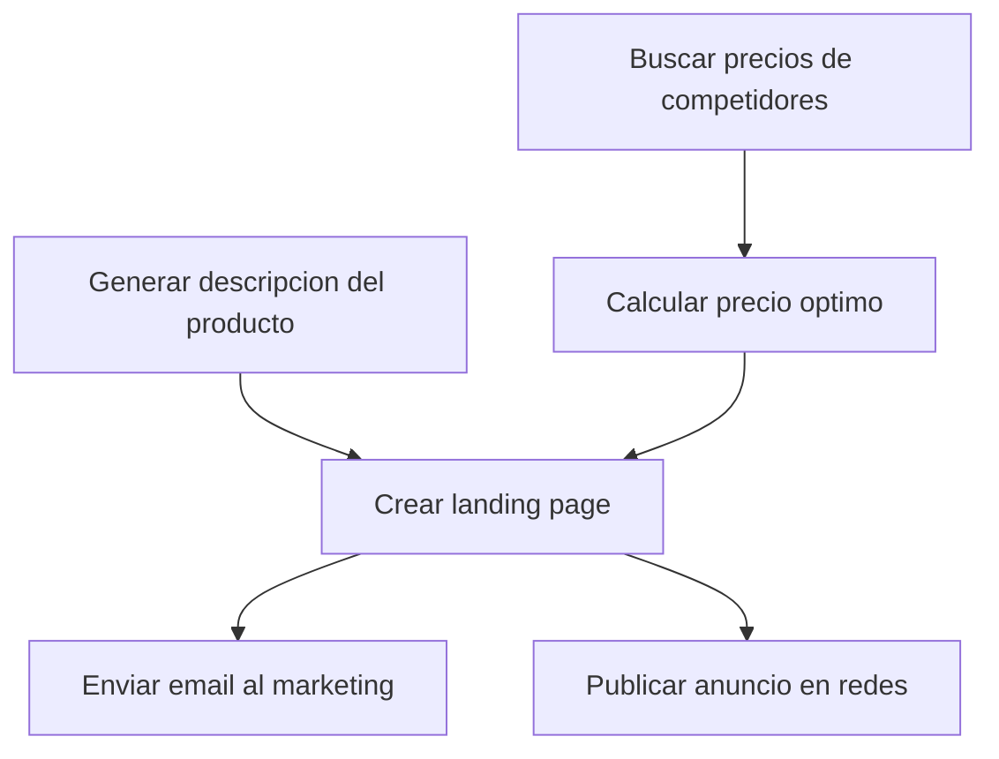

# Nemotron 3 Nano 30B — orchestration/parallel_vs_sequential_judgment

- model_id: `nvidia/nemotron-3-nano-30b-a3b`
- success: True  | final: 8.06 | quality: 8.57
- latency_total: 37.082s | tokens_per_second: 103.3
- input_tokens: 1440 | output_tokens: 3831

## Entrada exacta (lo que recibió el modelo)

**system:**

Eres un agente orquestador que optimiza la ejecucion.
Clasifica cada tarea como parallelizable o secuencial, justificando por que.
Las tareas paralelas se ejecutan al mismo tiempo para mayor velocidad.
Las tareas secuenciales dependen del resultado de una tarea anterior.

**user:**

Tengo estas 6 tareas para preparar el lanzamiento de un producto:

A. Buscar precios de competidores en el mercado
B. Generar la descripcion del producto basada en las specs tecnicas (archivo: /docs/specs.md)
C. Calcular el precio optimo basado en costos + margen + precios de competidores
D. Crear la landing page con la descripcion y precio
E. Enviar email al equipo de marketing con el enlace de la landing
F. Publicar anuncio en redes sociales

Analiza las dependencias y presenta:
1. Un diagrama de dependencias (que tarea depende de cual)
2. Un plan de ejecucion optimizado (que se puede hacer en paralelo)
3. El tiempo estimado si cada tarea toma ~5 minutos

Ejecuta las tareas que se pueden iniciar inmediatamente.

## Respuesta completa

**1. Diagrama de dependencias**

**Relaciones de dependencia**

- **A** → **C** (C necesita los precios de la competencia)  
- **C** → **D** (D necesita el precio calculado)  
- **B** → **D** (D necesita la descripción)  
- **D** → **E** (E necesita la landing page)  
- **D** → **F** (F necesita la landing page)  

**2. Plan de ejecución optimizado**

| Etapa | Tareas que pueden ejecutarse en paralelo | Comentario |
|------|-------------------------------------------|------------|
| **1** | **A** y **B** (no tienen predecesoras) | Se inician al mismo tiempo. |
| **2** | **C** (solo depende de A) | Espera a que A concluya. |
| **3** | **D** (depende de B y C) | Puede iniciar cuando ambas terminen. |
| **4** | **E** y **F** (ambas dependen de D) | Se ejecutan en paralelo después de D. |

**3. Tiempo estimado (≈5 min por tarea)**  

- **0‑5 min**: A y B en paralelo.  
- **5‑10 min**: C (requiere A).  
- **10‑15 min**: D (requiere B y C).  
- **15‑20 min**: E y F en paralelo (requieren D).  

**Tiempo total crítico: 20 min** (en lugar de 30 min si se ejecutaran secuencialmente).

**4. Ejecución inmediata de tareas iniciables**

Las tareas que pueden iniciarse de inmediato son **A** y **B**. Procederé a ejecutarlas usando las herramientas disponibles.

---  

*Ejecutando la tarea **B**: leer el archivo de especificaciones (`/docs/specs.md`).*  

**Herramienta:** `read_file`  

<|bash|>
{
  "path": "/docs/specs.md"
}
|>