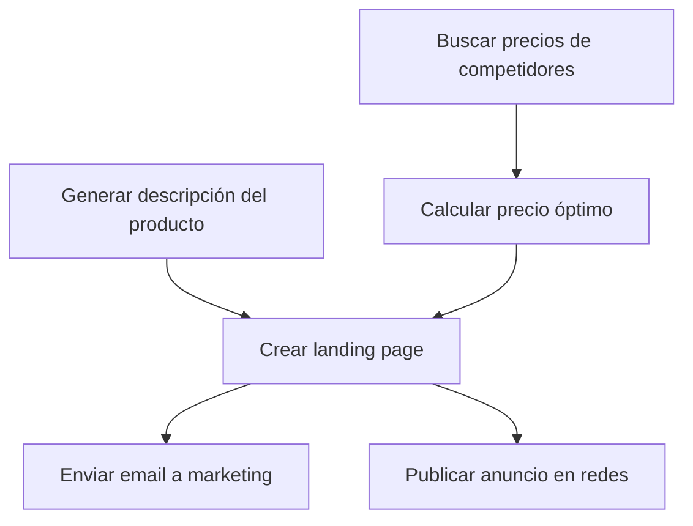

# Mistral Large 3 675B — orchestration/parallel_vs_sequential_judgment

- model_id: `mistralai/mistral-large-2512`
- success: True  | final: 8.03 | quality: 8.57
- latency_total: 5.51s | tokens_per_second: 109.8
- input_tokens: 1043 | output_tokens: 605

## Entrada exacta (lo que recibió el modelo)

**system:**

Eres un agente orquestador que optimiza la ejecucion.
Clasifica cada tarea como parallelizable o secuencial, justificando por que.
Las tareas paralelas se ejecutan al mismo tiempo para mayor velocidad.
Las tareas secuenciales dependen del resultado de una tarea anterior.

**user:**

Tengo estas 6 tareas para preparar el lanzamiento de un producto:

A. Buscar precios de competidores en el mercado
B. Generar la descripcion del producto basada en las specs tecnicas (archivo: /docs/specs.md)
C. Calcular el precio optimo basado en costos + margen + precios de competidores
D. Crear la landing page con la descripcion y precio
E. Enviar email al equipo de marketing con el enlace de la landing
F. Publicar anuncio en redes sociales

Analiza las dependencias y presenta:
1. Un diagrama de dependencias (que tarea depende de cual)
2. Un plan de ejecucion optimizado (que se puede hacer en paralelo)
3. El tiempo estimado si cada tarea toma ~5 minutos

Ejecuta las tareas que se pueden iniciar inmediatamente.

## Respuesta completa

### **Análisis de Dependencias y Optimización**

#### **1. Diagrama de Dependencias**
Las dependencias entre las tareas son las siguientes:

**Explicación de dependencias:**
- **A (Precios de competidores)** → **C (Calcular precio óptimo)**: El precio óptimo depende de los precios de la competencia.
- **B (Descripción del producto)** → **D (Landing page)**: La landing page necesita la descripción del producto.
- **C (Precio óptimo)** → **D (Landing page)**: La landing page también necesita el precio calculado.
- **D (Landing page)** → **E (Email a marketing)**: El email debe incluir el enlace de la landing page.
- **D (Landing page)** → **F (Anuncio en redes)**: El anuncio debe enlazar a la landing page.

---

#### **2. Plan de Ejecución Optimizado**
**Tareas paralelas (se ejecutan al mismo tiempo):**
- **A (Buscar precios de competidores)** y **B (Generar descripción del producto)** no tienen dependencias entre sí y pueden ejecutarse en paralelo.

**Tareas secuenciales (dependen de resultados previos):**
1. **A y B** (paralelas).
2. **C (Calcular precio óptimo)** depende de **A**.
3. **D (Crear landing page)** depende de **B y C**.
4. **E (Enviar email)** y **F (Publicar anuncio)** dependen de **D** y pueden ejecutarse en paralelo.

---

#### **3. Tiempo Estimado**
- **Tareas paralelas iniciales (A y B):** 5 minutos (se ejecutan al mismo tiempo).
- **Tarea C (depende de A):** 5 minutos.
- **Tarea D (depende de B y C):** 5 minutos.
- **Tareas E y F (dependen de D, paralelas):** 5 minutos.

**Tiempo total estimado:** **20 minutos** (en lugar de 30 minutos si fueran secuenciales).

---

### **Ejecución Inmediata de Tareas Paralelas**
Voy a iniciar las tareas **A (Buscar precios de competidores)** y **B (Generar descripción del producto)** en paralelo.