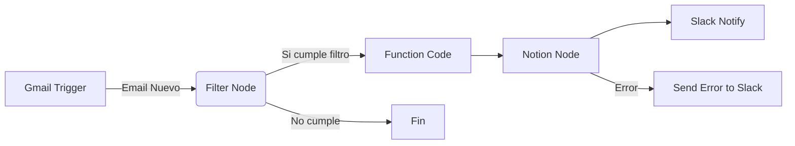

# Qwen 3.5 35B — multi_turn/requirements_change

- model_id: `qwen/qwen3.5-35b-a3b`
- success: True  | final: 4.7 | quality: 4.0
- latency_total: 10.275s | tokens_per_second: 139.3
- input_tokens: 233 | output_tokens: 1431

## Entrada exacta (lo que recibió el modelo)

**system:**

Eres un asistente tecnico para emprendedores que trabajan con N8N.

**user:**

Necesito un workflow en N8N que lea emails de Gmail, extraiga los datos del remitente, y los guarde en un Google Sheet.

**assistant:**

Perfecto, ese workflow es bastante directo. Te explico los pasos:

1. **Trigger**: Gmail Trigger (se activa con cada email nuevo)
2. **Extraer datos**: Function node para parsear remitente, asunto, fecha
3. **Guardar**: Google Sheets node para agregar una fila

Los campos a extraer serian: nombre del remitente, email, asunto, fecha. Quieres que te detalle la configuracion de cada nodo?

**user:**

En realidad, cambio de idea. No quiero Google Sheets, quiero que los datos vayan a Notion. Ademas, quiero que el workflow filtre solo los emails que tengan la palabra 'propuesta' o 'cotizacion' en el asunto. Y que me mande una notificacion a Slack cuando llegue uno.


## Respuesta completa

¡Excelente elección! El flujo de trabajo con Notion y Slack es mucho más robusto para gestionar leads o oportunidades comerciales.

Aquí tienes la configuración detallada del **Workflow en N8N** paso a paso para cumplir con tus nuevos requisitos:

### 📋 Arquitectura del Workflow



---

### 1. Nodo Trigger: Gmail
Configura este nodo para iniciar el proceso automáticamente.
*   **Operation:** `New Email`
*   **Authentication:** Conecta tu cuenta de Gmail (OAuth2).
*   **Folder:** `INBOX`
*   **Polling Interval:** Recomendado `Every Minute`.

### 2. Nodo Filter (Filtro)
Este es el paso crítico para evitar guardar datos irrelevantes. Configúralo así:

*   **Logic:** `All of the following conditions are true`
*   **Condition:**
    *   **Expression:** `{{ $json.subject }}`
    *   **Operator:** `Contains`
    *   **Value:** `Propuesta`
*   **Add Another Condition:**
    *   **Logic:** `OR`
    *   **Condition:** `{{ $json.subject }}`
    *   **Operator:** `Contains`
    *   **Value:** `Cotización`

> ⚠️ **Nota:** El operador "Contains" ignora mayúsculas/minúsculas por defecto, pero si quieres ser estricto, asegúrate de que los valores coincidan.

### 3. Nodo Code (Preparación de Datos)
Notion requiere una estructura específica para las bases de datos. Este nodo limpia los datos extraídos y los formatea para crear la página correctamente.

**JavaScript:**
```javascript
const { subject, from, date } = $input.all()[0].json;

// Formatear fecha para Notion (ISO 8601)
const formattedDate = new Date(date).toISOString();

return [
  {
    json: {
      subject: subject,
      from_name: from.name || from.address.split('@')[0],
      from_email: from.address,
      sent_date: formattedDate,
      // Aquí puedes agregar más lógica si necesitas procesar el cuerpo del email
    }
  }
];
```

### 4. Nodo Notion (Guardar Datos)
Para usar este nodo, necesitas crear un **Integration** en Notion y obtener el `Internal ID` de tu base de datos.

*   **Resource:** `Page`
*   **Operation:** `Create`
*   **Database ID:** Pega aquí el ID de tu tabla de Notion donde quieras guardar los datos.
*   **Mapping:**
    *   **Name:** `{{ $json.subject }}`
    *   **Propiedad Email:** `{{ $json.from_email }}` (Asegúrate de que la propiedad en Notion sea tipo "Email")
    *   **Propiedad Remitente:** `{{ $json.from_name }}` (Tipo "Text")
    *   **Propiedad Fecha:** `{{ $json.sent_date }}` (Tipo "Date")

### 5. Nodo Slack (Notificación)
Este nodo ejecuta solo si los pasos anteriores tienen éxito (conecta con el webhook de Slack).

*   **Webhook URL:** Tu Webhook Incoming de Slack.
*   **Message Type:** `Blocks` (Recomendado para mejor diseño)
*   **Content:**
    ```json
    {
      "blocks": [
        {
          "type": "header",
          "text": {
            "type": "plain_text",
            "text": "🚨 Nueva Propuesta Detectada"
          }
        },
        {
          "type": "section",
          "fields": [
            {
              "type": "mrkdwn",
              "text": "*Asunto:*\n{{ $json.subject }}"
            },
            {
              "type": "mrkdwn",
              "text": "*De:*\n{{ $json.from_name }}"
            }
          ]
        },
        {
          "type": "divider"
        },
        {
          "type": "section",
          "text": {
            "type": "mrkdwn",
            "text": "El registro se guardó exitosamente en Notion."
          }
        }
      ]
    }
    ```

---

### 💡 Consideraciones Técnicas Importantes

1.  **Integración de Notion:** No basta con el token OAuth2 estándar. Debes ir a Notion -> My Integrations, crear una nueva, copiar el **Internal Integration Token** y pegarlo en el nodo de autenticación de N8N. Además, debes dar permiso de acceso a la Base de Datos desde la integración dentro de la propia plataforma de Notion.
2.  **Estructura de Datos en Notion:** Antes de probar, crea una Base de Datos en Notion con columnas que coincidan con los nombres (`subject`, `from_name`, etc.) o ajusta el código en el nodo de Mapeo para usar los IDs de las propiedades.
3.  **Manejo de Errores:** Para producción, te recomiendo agregar un **Error Trigger** al final para enviar un mensaje de alerta en caso de fallo en el webhook de Slack o en la conexión con Notion.

¿Te gustaría que te ayude a configurar la integración de la API de Notion o prefieres revisar el código del nodo de filtrado?