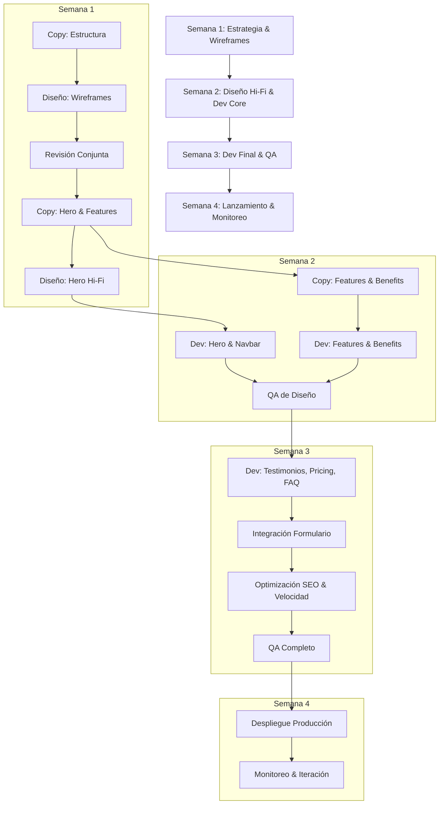

# Qwen 3.8 27B — task_management/project_breakdown

- model_id: `qwen/qwen3.8-27b`
- success: True  | final: 8.33 | quality: 10.0
- latency_total: 95.011s | tokens_per_second: 31.1
- input_tokens: 78 | output_tokens: 2951
- judge_score: 5 | justificación: La respuesta es precisa, relevante, profunda, clara y extremadamente útil, proporcionando un desglose detallado y estructurado que un emprendedor podría aplicar directamente.

## Entrada exacta (lo que recibió el modelo)

**user:**

Necesito lanzar una landing page para un nuevo producto SaaS de gestion de inventario. El lanzamiento es en 4 semanas. El equipo tiene 1 disenador, 2 developers y 1 copywriter. Desglosa el proyecto en fases, tareas, dependencias, responsables y un timeline realista.

## Respuesta completa

Este es un plan de ejecución detallado y realista para lanzar tu landing page de SaaS de gestión de inventario en **4 semanas (20 días hábiles)**.

### Premisas Clave para el Éxito
1.  **Alcance Acotado (Scope Creep Killer):** La landing page es *solo* para captación de leads o registro inicial. No incluye dashboard, login ni funcionalidad del producto.
2.  **Stack Técnico:** Se asume un stack moderno y rápido (ej. Next.js, Astro, o React + Tailwind CSS) para que los 2 developers puedan moverse con agilidad.
3.  **Iteración:** El diseño no se "termina" antes de desarrollar. Se trabaja en paralelo con wireframes y prototipos de baja fidelidad.
4.  **Copywriting:** El copy debe estar aprobado antes de que los developers empiecen a codificar secciones finales.

---

### Resumen del Equipo y Roles
*   **1 Diseñador (D):** Wireframes, UI en Figma, assets visuales, handoff.
*   **2 Developers (Dev1, Dev2):** Frontend, SEO técnico, integración de analytics/form, optimización de velocidad.
*   **1 Copywriter (C):** Estructura de mensajes, textos finales, CTAs, A/B testing de headlines.

---

### Fase 1: Estrategia, Wireframes y Copy Inicial (Semana 1)
**Objetivo:** Tener la estructura visual y textual aprobada para evitar rework costoso en desarrollo.

| Día | Tarea | Responsable | Dependencias | Entregable |
|-----|-------|-------------|--------------|------------|
| **Día 1** | Kickoff: Definir propuesta de valor única (UPV), audiencia objetivo y objetivo principal (Lead gen vs. Trial). | Todos | - | Documento de estrategia de 1 página. |
| **Día 2** | **Copy:** Estructura de la landing (Hero, Problema, Solución, Features, Testimonios, Pricing, FAQ, CTA). Redacción de borrador inicial. | C | Estrategia aprobada | Borrador de copy en Notion/Docs. |
| **Día 2** | **Diseño:** Crear wireframes de baja fidelidad (box model) basados en la estructura de copy. | D | Estructura de copy | Wireframes en Figma. |
| **Día 3** | **Revisión:** Revisión conjunta de wireframes. Ajustes de flujo. | Todos | Wireframes | Wireframes v1.0 aprobados. |
| **Día 4** | **Copy:** Redacción final de secciones clave (Hero, Beneficios principales). | C | Wireframes aprobados | Copy final de secciones hero y features. |
| **Día 4** | **Dev:** Setup del proyecto (repo, CI/CD, stack básico, configuración de Tailwind/Next.js). | Dev1, Dev2 | - | Repositorio inicial con "Hello World" desplegado en staging. |
| **Día 5** | **Diseño:** Iniciar diseño de alta fidelidad (Hi-Fi) del Hero y Navbar. | D | Wireframes + Copy Hero | Diseños Hi-Fi de Hero. |
| **Día 5** | **Dev:** Crear estructura base (Header, Footer, sistema de componentes básico). | Dev2 | Setup completo | Componentes Header/Footer funcionales. |

**✅ Hito Fin Semana 1:** Wireframes aprobados, Copy del 50% listo, Setup técnico operativo.

---

### Fase 2: Diseño UI y Desarrollo Core (Semana 2)
**Objetivo:** Tener el 80% del diseño visual terminado y el 50% del código desarrollado.

| Día | Tarea | Responsable | Dependencias | Entregable |
|-----|-------|-------------|--------------|------------|
| **Día 8** | **Diseño:** Diseñar Hi-Fi de secciones de Features y Solución. | D | Wireframes aprobados | Diseños Hi-Fi de Features. |
| **Día 8** | **Copy:** Redacción de secciones de "Cómo funciona" y "Beneficios". | C | Estructura aprobada | Copy de secciones centrales. |
| **Día 9** | **Dev:** Implementar Hero Section (responsive, animaciones ligeras). | Dev1 | Diseños Hero, Copy Hero | Hero funcional en staging. |
| **Día 9** | **Dev:** Implementar Navbar y Footer. | Dev2 | Componentes base | Navbar/Footer funcionales. |
| **Día 10** | **Diseño:** Diseñar Hi-Fi de Testimonios, Pricing y FAQ. | D | Wireframes | Diseños Hi-Fi de secciones inferiores. |
| **Día 10** | **Copy:** Redacción de Testimonios (mockups si no hay clientes reales aún) y Pricing. | C | Estructura | Copy de Testimonios y Pricing. |
| **Día 11** | **Dev:** Implementar sección de Features (con assets de imagen/iconos). | Dev1 | Diseños Features, Copy | Sección Features funcional. |
| **Día 11** | **Dev:** Implementar sección de "Cómo funciona" o "Beneficios". | Dev2 | Diseños Solución, Copy | Sección Beneficios funcional. |
| **Día 12** | **Diseño:** Handoff de estilos (tokens de color, tipografía, espaciados) a Devs. | D | Diseños Hi-Fi completos | Tokens de diseño documentados. |
| **Día 12** | **Dev:** Revisión cruzada de código. Ajustes de responsividad en secciones ya hechas. | Dev1, Dev2 | Código de Días 9-11 | Código limpio y responsive en secciones principales. |

**✅ Hito Fin Semana 2:** 80% del diseño en Figma, 50% del código desarrollado, Copy del 80% listo.

---

### Fase 3: Desarrollo Final, Integración y QA (Semana 3)
**Objetivo:** Landing page funcional al 100%, optimizada para velocidad y SEO.

| Día | Tarea | Responsable | Dependencias | Entregable |
|-----|-------|-------------|--------------|------------|
| **Día 15** | **Diseño:** Revisar implementaciones en staging. Ajustes finos de espaciado/colores. | D | Código en staging | Feedback de QA de diseño. |
| **Día 15** | **Copy:** Revisión final de todos los textos. Ajustar CTAs. | C | Copy completo | Copy 100% aprobado. |
| **Día 16** | **Dev:** Implementar secciones de Testimonios, Pricing y FAQ. | Dev1, Dev2 | Diseños, Copy | Secciones inferiores funcionales. |
| **Día 16** | **Dev:** Integrar formulario de contacto/registro (Mailchimp, HubSpot, o API propia). | Dev2 | Formulario de diseño | Formulario funcional con validación. |
| **Día 17** | **Dev:** Optimización de imágenes (WebP/AVIF), lazy loading. | Dev1 | Todos los assets | Imágenes optimizadas. |
| **Día 17** | **Dev:** Implementar SEO básico (Meta tags, OG tags, sitemap.xml, robots.txt). | Dev1, Dev2 | Estructura final | SEO técnico implementado. |
| **Día 18** | **QA:** Testing en múltiples dispositivos (móvil, tablet, desktop). | Todos | Landing en staging | Lista de bugs. |
| **Día 18** | **QA:** Verificar velocidad de carga (Lighthouse score > 90). | Dev1 | Landing en staging | Reporte de rendimiento. |
| **Día 19** | **Dev:** Corregir bugs críticos y ajustes de diseño. | Dev1, Dev2 | Lista de bugs | Landing sin bugs críticos. |
| **Día 19** | **Copy:** Última revisión de textos en el contexto visual. | C | Landing en staging | Copy final aprobado en contexto. |

**✅ Hito Fin Semana 3:** Landing page completa, testeada, optimizada y lista para producción.

---

### Fase 4: Lanzamiento y Monitoreo (Semana 4)
**Objetivo:** Despliegue en producción, verificación final y monitoreo de métricas.

| Día | Tarea | Responsable | Dependencias | Entregable |
|-----|-------|-------------|--------------|------------|
| **Día 22** | **Dev:** Despliegue a producción (Production). | Dev1 | QA aprobado | Landing en vivo. |
| **Día 22** | **Verificación:** Smoke test en producción (form funciona, enlaces, analytics). | Todos | Despliegue | Confirmación de funcionamiento. |
| **Día 23** | **Marketing:** Activar campañas de email, redes sociales, etc. | (Fuera de equipo, pero coordinar) | Landing en vivo | Tráfico inicial. |
| **Día 24** | **Monitoreo:** Revisar métricas de conversión, errores en consola, velocidad. | Dev1 | Tráfico real | Reporte de primer día. |
| **Día 25** | **Iteración:** Identificar puntos de fricción. Planificar A/B testing de Hero/CTA. | Todos | Datos de 2 días | Plan de optimización post-lanzamiento. |

**🚀 Hito Final:** Producto en vivo, monitoreo activo, plan de mejora definido.

---

### Mapa de Dependencias Críticas (Gantt Simplificado)

### Riesgos y Mitigaciones

| Riesgo | Probabilidad | Impacto | Mitigación |
|--------|-------------|---------|------------|
| **Copy tardío** | Media | Alto | El copywriter debe entregar el 80% del copy en la Semana 1. Los developers usan texto placeholder (Lorem Ipsum) solo por 2 días máximo. |
| **Cambio de alcance** | Alta | Alto | Cualquier cambio de funcionalidad o sección nueva se pospone para la "Fase 2" post-lanzamiento. La landing se mantiene mínima. |
| **Bugs de responsive** | Media | Medio | Los developers deben probar en móvil desde el Día 9, no esperar a la Semana 3. |
| **Velocidad de carga baja** | Media | Medio | Usar imágenes optimizadas desde el inicio. Evitar librerías pesadas de animación. |

### Consejos para el Equipo

1.  **Comunicación Diaria (Standups):** 15 minutos cada mañana. ¿Qué hiciste ayer? ¿Qué harás hoy? ¿Qué te bloquea?
2.  **Herramientas:**
    *   **Figma:** Para diseño y prototipado.
    *   **GitHub/GitLab:** Para código.
    *   **Notion/Trello:** Para gestión de tareas.
    *   **Slack/Teams:** Para comunicación rápida.
3.  **Enfoque en el CTA:** Todo en la landing debe apuntar a una sola acción principal (ej. "Prueba Gratis", "Solicita Demo"). No diluir el mensaje.
4.  **SEO desde el Día 1:** Los developers deben configurar meta tags y estructura semántica (H1, H2, alt texts) mientras codifican, no al final.

Este plan es agresivo pero realista si el equipo se mantiene enfocado y evita desviaciones de alcance. ¡Éxito en el lanzamiento! 🚀