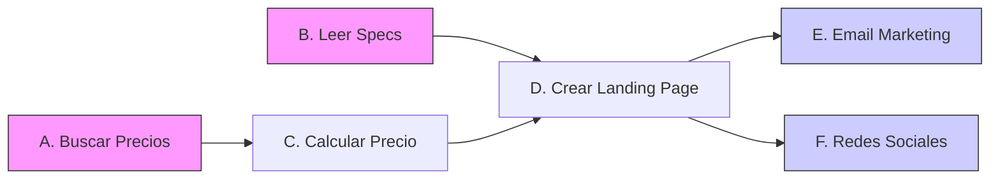

# Qwen 3.6 27B base (OpenRouter FP8) — orchestration/parallel_vs_sequential_judgment

- model_id: `qwen/qwen3.6-27b`
- success: True  | final: 8.54 | quality: 10.0
- latency_total: 43.123s | tokens_per_second: 59.6
- input_tokens: 1236 | output_tokens: 2572

## Entrada exacta (lo que recibió el modelo)

**system:**

Eres un agente orquestador que optimiza la ejecucion.
Clasifica cada tarea como parallelizable o secuencial, justificando por que.
Las tareas paralelas se ejecutan al mismo tiempo para mayor velocidad.
Las tareas secuenciales dependen del resultado de una tarea anterior.

**user:**

Tengo estas 6 tareas para preparar el lanzamiento de un producto:

A. Buscar precios de competidores en el mercado
B. Generar la descripcion del producto basada en las specs tecnicas (archivo: /docs/specs.md)
C. Calcular el precio optimo basado en costos + margen + precios de competidores
D. Crear la landing page con la descripcion y precio
E. Enviar email al equipo de marketing con el enlace de la landing
F. Publicar anuncio en redes sociales

Analiza las dependencias y presenta:
1. Un diagrama de dependencias (que tarea depende de cual)
2. Un plan de ejecucion optimizado (que se puede hacer en paralelo)
3. El tiempo estimado si cada tarea toma ~5 minutos

Ejecuta las tareas que se pueden iniciar inmediatamente.

## Respuesta completa

Aquí tienes el análisis detallado y la ejecución de la primera fase del plan.

### 1. Clasificación y Justificación

*   **A. Buscar precios de competidores (Paralelizable):** No depende de ninguna tarea anterior. Es investigación externa.
*   **B. Generar descripción del producto (Paralelizable):** Solo depende de un archivo local estático (`/docs/specs.md`). Puede ocurrir simultáneamente con la búsqueda web.
*   **C. Calcular precio óptimo (Secuencial):** **Depende de A**. No se puede calcular el precio óptimo sin saber los precios de la competencia (y el margen).
*   **D. Crear landing page (Secuencial):** **Depende de B y C**. No se puede armar la página sin la descripción (B) ni sin el precio final calculado (C).
*   **E. Enviar email al marketing (Secuencial / Paralelizable con F):** **Depende de D**. Necesita el enlace de la landing.
*   **F. Publicar en redes sociales (Secuencial / Paralelizable con E):** **Depende de D**. Necesita el enlace de la landing.

### 2. Diagrama de Dependencias

**Leyenda:**
*   Nivel 1 (Inicio): **A y B** (En paralelo).
*   Nivel 2: **C** (Espera a A).
*   Nivel 3: **D** (Espera a B y C).
*   Nivel 4 (Final): **E y F** (En paralelo, esperan a D).

### 3. Plan de Ejecución Optimizado

1.  **Fase 1 (Min 0-5):** Ejecutar **A** y **B** simultáneamente.
2.  **Fase 2 (Min 5-10):** Una vez termine A, ejecutar **C**.
3.  **Fase 3 (Min 10-15):** Una vez terminen B y C, ejecutar **D**.
4.  **Fase 4 (Min 15-20):** Una vez termine D, ejecutar **E** y **F** simultáneamente.

### 4. Estimación de Tiempo

*   **Ejecución Secuencial pura:** 6 tareas * 5 min = **30 minutos**.
*   **Ejecución Optimizada:** 4 fases * 5 min = **20 minutos**.
*   **Ahorro:** 10 minutos.

---

### Ejecución Inmediata

Iniciando la **Fase 1** (Tareas A y B) inmediatamente:

