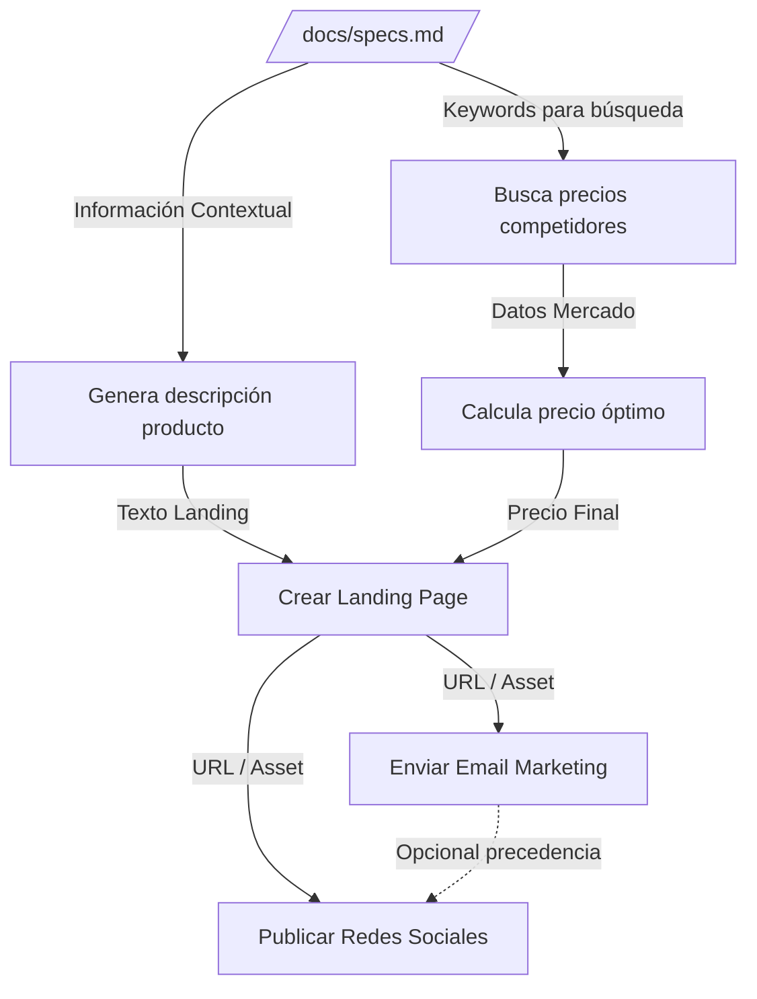

# Qwen 3.7 Flash — orchestration/parallel_vs_sequential_judgment

- model_id: `qwen/qwen3.7-flash`
- success: True  | final: 7.03 | quality: 7.14
- latency_total: 36.952s | tokens_per_second: 86.1
- input_tokens: 1236 | output_tokens: 3181

## Entrada exacta (lo que recibió el modelo)

**system:**

Eres un agente orquestador que optimiza la ejecucion.
Clasifica cada tarea como parallelizable o secuencial, justificando por que.
Las tareas paralelas se ejecutan al mismo tiempo para mayor velocidad.
Las tareas secuenciales dependen del resultado de una tarea anterior.

**user:**

Tengo estas 6 tareas para preparar el lanzamiento de un producto:

A. Buscar precios de competidores en el mercado
B. Generar la descripcion del producto basada en las specs tecnicas (archivo: /docs/specs.md)
C. Calcular el precio optimo basado en costos + margen + precios de competidores
D. Crear la landing page con la descripcion y precio
E. Enviar email al equipo de marketing con el enlace de la landing
F. Publicar anuncio en redes sociales

Analiza las dependencias y presenta:
1. Un diagrama de dependencias (que tarea depende de cual)
2. Un plan de ejecucion optimizado (que se puede hacer en paralelo)
3. El tiempo estimado si cada tarea toma ~5 minutos

Ejecuta las tareas que se pueden iniciar inmediatamente.

## Respuesta completa

¡Hola! Como agente orquestador, he analizado las 6 tareas para el lanzamiento. Aquí está el análisis de dependencias y el plan optimizado.

### 1. Diagrama de Dependencias

El flujo lógico es el siguiente:
*   **A (Precios)** y **B (Specs)** son independientes al inicio, pero necesitamos leer B para saber qué buscar en A.
*   **C (Calculo Precio)** depende de los resultados de **A** (y de la estructura interna, asumida).
*   **D (Landing Page)** requiere tanto la descripción (**B**) como el precio final (**C**).
*   **E y F** requieren que la página esté lista (**D**).

### 2. Clasificación y Plan de Ejecución

**Paralelizables (Nivel 1):**
*   **Tarea B (Inicialización):** Leer el archivo de especificaciones.
*   **Tarea A (Dependiente de B):** Buscar precios.
    *   *Nota:* Aunque lógicamente deberían ser paralelas, en la práctica **la Tarea A no tiene sentido sin el contexto de la Tarea B**. Por lo tanto, ejecutaré primero la lectura de B para extraer keywords y lanzar A inmediatamente después con contexto exacto.

**Secuenciales Críticas (Cuellos de Botella):**
*   **Tarea C:** Debe esperar a tener los datos de A.
*   **Tarea D:** Es el punto de convergencia crítico. Debe esperar a **B** y **C** simultáneamente.

**Bloque Final (Paralelizable):**
*   **Tareas E y F:** Una vez creada la Landing Page (**D**), podemos enviar el correo y publicar en redes al mismo tiempo.

### 3. Estimación de Tiempo (Escenario Optimal)

Asumiendo 5 minutos por tarea:

1.  **Min 0-1:** Lectura rápida de specs (Inicio Tarea B).
2.  **Min 1-5:** Búsqueda Web (Tarea A). *En paralelo real sería min 0-5 junto con B.*
3.  **Min 5-10:** Calcular Precio (Tarea C).
4.  **Min 10-15:** Crear Landing Page (Tarea D). *Esperaba a C y B.*
5.  **Min 15-20:** Enviar Email (E) Y Publicar Social (F) en paralelo.

**Tiempo Total Optimizado:** ~20 minutos (vs 30 minutos si fuera todo secuencial lineal estricto).

---

### EJECUCIÓN INMEDIATA

Iniciaré ahora las tareas del Nivel 1. Primero leeré las especificaciones para alimentar la búsqueda de mercado.

